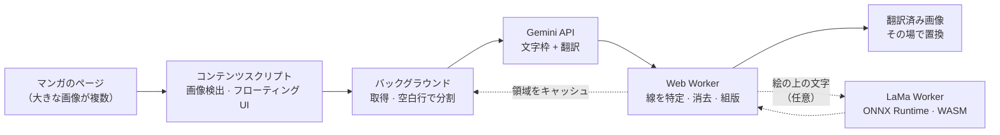

<div align="center">


# COMIC TRANS

**漫画・マンガ・縦読みウェブトゥーンをページ上でそのまま翻訳。元の文字を一画ずつ消して、訳文をその場に描き直します。**

[](https://github.com/ToanCreator/COMIC-TRANS/releases)
[](LICENSE)
[](#-無料オープンソース)
[](https://github.com/ToanCreator/COMIC-TRANS)
[](#-技術スタック)
[](#-技術スタック)
[](#-コントリビュート)

[English](README.md) · [Tiếng Việt](README.vi.md) · [简体中文](README.zh-CN.md) · **🌐 日本語**

<!-- ⬇️ 下のリンクを実際のストアの URL に置き換えてください -->
[](https://addons.mozilla.org/firefox/addon/comic-trans/)
[](https://chromewebstore.google.com/detail/YOUR-EXTENSION-ID)
<!-- Chrome 版の公開後、"%E8%BF%91%E6%97%A5%E5%85%AC%E9%96%8B"（近日公開）を "%E6%8B%A1%E5%BC%B5%E6%A9%9F%E8%83%BD%E3%82%92%E5%85%A5%E6%89%8B"（拡張機能を入手）に変更 -->

</div>

---

<!-- 📸 ここにデモ GIF またはビフォー/アフター画像を追加してください。例：
<p align="center"></p>
-->

## ✨ COMIC TRANS とは？

多くの漫画翻訳ツールは、元の文字の上にテキストボックスを重ねるだけです。**COMIC TRANS** はさらに踏み込み、**元の文字を構成するピクセルを特定して消し、下の絵を補修し、訳文を描き込みます**。ページはまるで自分の言語で出版されたかのように仕上がります。

必要なのは**ご自身の [Google Gemini](https://ai.google.dev/) API キー**だけ。それ以外の処理――画像処理、文字消去、組版、キャッシュ――はすべて**ブラウザ内でローカルに実行**されます。

> モバイルファーストで設計（Firefox for Android に対応）。デスクトップでも快適に使えます。

## 🚀 機能

| | |
|---|---|
| 🧽 **本物の文字消去** | ぼやけた四角で塗りつぶすのではなく、元の文字を一画ずつ消します。吹き出しの枠線は残ります。 |
| 🖌️ **スマートな組版** | 訳文は吹き出しに収まるよう調整され、枠線や消していない線の手前で止まり、他の文字に重なりません。 |
| 📜 **ウェブトゥーン対応** | 長い縦画像は*コマとコマの間の空白行*で分割するため、文字が途中で切れません。 |
| ⚡ **高速・並列** | キーごとの並列数制限、HTTP 429 での自動減速と回復時の自動加速。キーを複数追加すれば速度が倍増します。 |
| 📱 **タッチ優先 UI** | フローティングボタン、タップで画像を選択、指で囲んで小さな文字を再翻訳、タッチ領域は 44px 以上。 |
| 🔁 **即時再描画** | 文字領域は画像ごとにキャッシュ。フォントやサイズを変えても**API を再呼び出しせず**すぐ描き直せます。 |
| 🧠 **自己修正** | 任意の校正ステップで意味不明な語や誤字を修正。ベトナム語の声調記号が欠けた場合は自動復元します。 |
| 📖 **用語集とトーンメモ** | 作品ごとに固有名詞を統一し、呼称や文体を指定できます。 |
| 📄 **PDF 書き出し** | 翻訳済みの章を PDF として保存（PDF ライブラリ不使用の自前生成）。 |
| 🌍 **180 以上の言語** | Gemini が対応する任意の言語ペアで翻訳。UI は **English / Tiếng Việt / 日本語 / 中文** に対応。 |
| 🤖 **AI による文字消去（LaMa）** *(任意)* | 絵の上に直接描かれた文字を、インペインティングモデル **LaMa** で消去します。**ブラウザ内で実行**（ONNX Runtime + WebAssembly）され、モデルは一度だけダウンロード（約 208 MB）して保存されます。エラー時は自動的に高速な方法へ戻ります。 |
| 🪟 **パネルとシステムウィンドウ** | ゲーム風のステータス窓、通知、複数行の長文パネルを独立した種類として認識し、フラットなパネルとして塗り直します。 |
| 🔒 **設計段階からプライバシー重視** | アカウント不要、テレメトリなし、独自サーバーなし。[プライバシーとセキュリティ](#-プライバシーとセキュリティ)を参照。 |

## 🆕 2.6.0 の新機能

*2.3.0 からの変更点です。*

- 🤖 **LaMa による AI 文字消去** — 任意・初期状態はオフ・完全ローカル実行。模様のある絵の上の文字が対象で、従来の塗りつぶしでは柔らかくなりがちな場面を狙っています。[詳細](#-オプションai-による文字消去lama)
- 🪟 **新しい領域タイプ：システムウィンドウ／長文パネル**（設定を追加、初期状態はオン）。
- 🧵 **細い継ぎ目の補修** — 1〜3 px のまっすぐな線（画像の継ぎ目やコマの接合部）を背景として扱うため、線に接した文字も消せ、フキダシが二つに割れません。
- 🫧 **フキダシの「ポケット」がより堅牢に** — 輪郭が分かった*後*にフキダシの背景を計算し、3 px のバリアで塞ぐため、トゲ状や隙間のある輪郭でも中の文字を正しく含みます。
- 📊 **設定画面のモデル管理** — 速度・残り時間・経過時間つきの進捗バー、ダウンロード中止、*ダウンロード済みモデルを削除*。

## 📦 インストール

### Firefox（推奨）

1. アドオンページを開く → **[Firefox 版 COMIC TRANS を入手](https://addons.mozilla.org/firefox/addon/comic-trans/)**
2. **Firefox に追加**をクリック。

### Chrome / Edge / Brave

近日公開予定です。[ロードマップ](#-ロードマップ)をご覧ください。進捗は [Issues](https://github.com/ToanCreator/COMIC-TRANS/issues) で確認できます。

### ソースから（任意の Firefox、開発者向け）

```bash
git clone https://github.com/ToanCreator/COMIC-TRANS.git
```

1. `about:debugging#/runtime/this-firefox` を開く
2. **Load Temporary Add-on…** をクリックして `manifest.json` を選択
3. 設定タブが自動で開きます。

> 一時的なアドオンは Firefox を閉じると削除されます。恒久的に使うには、ストア版を利用するか、`web-ext sign` で自分のビルドに署名してください。

## 🧭 クイックスタート

1. [Google AI Studio](https://aistudio.google.com/apikey) で**無料の Gemini API キーを取得**します。
2. **COMIC TRANS → 設定**を開き、キーを貼り付けます（1 行に 1 つ。キーが多いほど高速）。**キーを確認**を押します。
3. **原文の言語**と**翻訳先の言語**を選びます。
4. 任意の漫画ページを開き、**フローティングボタン**（右下、ドラッグ可）をタップします。

| モード | 動作 |
|---|---|
| **ページ全体を翻訳** | 表示中の画像を優先し、残りは並列処理 |
| **表示中の画像** | 画面中央にある画像のみ |
| **ここから下** | 現在の画像とそれ以降すべて――ウェブトゥーンに最適 |
| **タップして選択** | タップした画像だけを翻訳 |
| **範囲選択** | 小さな文字を囲むと拡大して読み取り、結果に統合 |
| **スクロールで自動翻訳** | これから表示される画像を先回りして翻訳 |
| **原文表示 / PDF 書き出し** | 比較や保存に |

**デスクトップのショートカット：** `Alt+Shift+T` パネル表示/非表示 · `Alt+Shift+Y` ページ全体を翻訳 · 画像を右クリック → *この画像を翻訳*。

### 🤖 オプション：AI による文字消去（LaMa）

1. **設定 → AI による文字消去（LaMa）** で *絵の上の文字を AI で消す* をオンにします（*絵の上に直接書かれた文字* はオンのままにします）。
2. **モデルをダウンロード／確認** を押します。既定のモデルは**一度だけのダウンロード（約 208 MB）**で、進捗バー・速度・残り時間・中止ボタンが表示されます。モデルはブラウザのキャッシュストレージに保存され、*ダウンロード済みモデルを削除* でいつでも消せます。
3. いつも通り翻訳します。模様のある絵の上の文字は LaMa が消し、フキダシやフラットなパネルは従来の高速な方法のままです。

> 手順 2 を省略しても、最初の翻訳時にモデルのダウンロードが自動で始まります。
> ONNX Runtime のファイルは `vendor/`（約 40 MB）にあります。お手元のリポジトリに無い場合は `tools/get-lama-assets.sh`（Windows は `.ps1`）を実行してください。
> 既定の方法より遅く、特にスマートフォンで顕著です。翻訳を妨げることはなく、エラー時は高速な方法の結果をそのまま使います。

## ⚙️ 仕組み



1. **検出** — コンテンツスクリプトがマンガサイズの画像（遅延読み込みを含む）を見つけ、サイトの CSS と干渉しない Shadow DOM の軽量パネルを表示します。
2. **分割** — 縦長の画像は固定の高さではなく、コマの間の最も「静かな」横行で切ります。
3. **モデルには*少なめ*に頼む** — Gemini が返すのは視覚モデルが得意なことだけ：**文字枠、翻訳、領域タイプ**（フキダシ、キャプション、自由文字、効果音、システムパネル）。重い処理は端末側で行います。
4. **本当のインクを見つける** — モデルの枠は小さすぎたりずれたりしがちなので、「種」としてだけ使います。Worker は同じフキダシ内の隣り合う線に沿って広げ（局所背景での flood-fill、絵の上の文字には top-hat / black-hat 形態学）、文字全体のマスクを得ます。細い継ぎ目や輪郭の隙間は先に補修され、隣のフキダシとつながりません。
5. **消去 — 高速パス** — マスク内の画素を push-pull 塗りつぶし＋粒状ノイズの合成で埋め、絵になじませます。文字が見つからなければ**画像はそのまま**です。フキダシとフラットな背景（色付きの枠、単色の空など）は常にこの正確な方法を使います。
6. **消去 — 任意の AI パス** — *AI による文字消去* がオンで、文字が実際に模様のある絵の上にある場合、**LaMa** で仕上げます：マスクの周囲に十分な文脈を含む正方形を切り出し、**512 × 512** に変換して、ONNX Runtime Web（WebAssembly）でモデルを動かす専用 Worker（全体で 1 つ）へ送ります。貼り戻すのは**マスク内**の画素だけで、それ以外は一切変わりません。エラーやタイムアウト時は高速パスの結果を維持します。
7. **組版** — 翻訳文を折り返して空き領域に収め、枠線や消し残した線の手前で止めます。
8. **キャッシュ** — 領域は画像ごとに保存されるので、スタイル変更は即時かつ無料です。

## 🛠️ エンジニアリングのポイント

*興味のある方、そしてコードをレビューする方へ。*

- **依存はほぼゼロ。** 素の JavaScript（ES2020）、WebExtension API、Web Worker。バンドラーもフレームワークも、実行時の `node_modules` もありません。サードパーティの実行時コンポーネントは **ONNX Runtime Web**（`vendor/` に同梱）のみで、AI 消去を有効にしたときだけ読み込まれます。
- **純粋でテストしやすいコア。** `worker/core.js` は DOM に触れないため、同じアルゴリズムが Web Worker でも Node（テスト）でも動きます。
- **コンピュータビジョンのパイプラインを一から実装。** 支配色の解析、行／列ごとのインク統計、モルフォロジー（オープニング／クロージング）、連結成分のグルーピング、継ぎ目補修、push-pull インペインティング、ノイズ推定と粒状感の合成、IoU による重複除去。
- **ニューラルインペインティングの丁寧な統合。** 共有の LaMa Worker が、画像 Worker ごとの `MessageChannel` ポートを通じて Worker プール全体にサービスします（モデルは一度だけ読み込み）。リクエストは直列化され、切り出し／テンソル化／貼り戻しは純粋モジュール `lamafill.js` に集約。モデル出力の範囲（0–1 か 0–255）は自動判定し、120 秒のタイムアウトと穏やかなフォールバックにより、AI が翻訳を壊すことはありません。
- **モデル配信も丁寧に。** 進捗・速度・残り時間つきのストリーミングダウンロード。`Content-Length` からバッファを事前確保してスマートフォンの RAM 倍増を回避。モデルは Cache Storage に永続化。数百 MB をダウンロードする*前に*ランタイムファイルを検査します。
- **堅牢な API クライアント。** 小さなテスト画像で各モデルが受け付ける設定（thinking → safety → JSON スキーマ）を調べ、段階的に縮退。途中で切れた JSON の救出、キーごとの適応的な並列数による 429 対応、同じクォータプロジェクトを共有するキーの検出。
- **ページを止めない。** 重い画素処理は CPU コア数に応じた Worker プールで実行します。
- **自前の PDF 書き出し。** 章のエクスポートは、手書きの小さな PDF シリアライザで生成します。
- **最初から多言語。** UI は 4 言語、ブラウザの言語から自動判定。
- **多層のテスト。** 合成マンガページでのアルゴリズムテスト、ユニット／フローテスト（モデルの拒否、クォータ 0、429、JSON の切断、不正なキー、404、任意権限の欠如）、モバイルビューポートで Playwright による実ブラウザの E2E／タッチ UI テスト。

## 🔒 プライバシーとセキュリティ

- **API キーはブラウザ内にのみ保存**され（`browser.storage.local`）、送信先は `generativelanguage.googleapis.com` **だけ**です。
- 通信先は**次の 2 種類のみ**：**Gemini API**（翻訳）と、*AI 文字消去をオンにした場合に限り*、**`huggingface.co` からのモデルファイルの一回限りのダウンロード**（URL は設定で変更可能）。マンガの画像が Hugging Face に送られることは**一切ありません**。モデルはローカルで動作し、その後はブラウザに保存されます。
- 解析なし、トラッキングなし、アカウント不要。
- ⚠️ 翻訳のため、**選択した画像は Google の Gemini API に送信されます**。お使いのキーのプランに対する Google の規約が適用されます（無料枠のデータは Google の現行ポリシーに従って利用される場合があります。必ずご確認ください）。送信したくない内容は翻訳しないでください。
- `x-goog-api-key` ヘッダーが写ったスクリーンショットは共有しないでください。キーが漏れたら、失効させて新しく作成してください。

## 🧰 技術スタック

`JavaScript` · `WebExtensions（Firefox、Manifest V2）` · `Web Workers` · `Canvas / ImageData` · `Google Gemini API` · `ONNX Runtime Web (WASM)` · `LaMa インペインティング (ONNX)` · `Node.js + Playwright（テスト）`

## 🗂️ プロジェクト構成

```
COMIC-TRANS/
├── manifest.json          # WebExtension マニフェスト（v2.6.0）
├── background/
│   ├── main.js            # 全体制御：取得、分割、キュー、キャッシュ、キーごとの並列数、
│   │                      #   Worker プール + LaMa モデルのダウンロード／保存／起動
│   ├── gemini.js          # Gemini クライアント：プロンプト、解析、リトライ、自己診断
│   └── settings.js        # 既定値と保存
├── content/content.js     # 画像検出、フローティングパネル（Shadow DOM）、タッチ操作、PDF 書き出し
├── worker/
│   ├── core.js            # 純粋なアルゴリズム：文字マスク、継ぎ目、インペインティング、組版、分割
│   ├── worker.js          # 画像 Worker：分割、消去、組版、LaMa クライアント
│   ├── lamafill.js        # LaMa の前／後処理（純粋）：切り出し計画、512×512 テンソル、貼り戻し
│   └── lama_worker.js     # ONNX セッションを動かす唯一の Worker
├── vendor/                # ONNX Runtime Web 1.17.3（JS + WASM）— AI 消去でのみ使用
├── options/               # 設定ページ（モデル管理を含む）
├── shared/                # UI 文言（en/vi/ja/zh）と言語リスト
├── tools/                 # get-lama-assets.sh / .ps1 — vendor のファイルを取得
└── tests/                 # ユニット、フロー、アルゴリズム、ブラウザ E2E テスト
```

## 🧪 開発とテスト

```bash
cd tests
python3 make_synth.py && python3 make_tall.py && python3 make_widths.py   # 合成漫画ページを生成
node test_units.js && node test_flow.js && node run_core.js               # 単体 + フロー + コア
node browser_worker_test.js && node browser_content_test.js && node browser_e2e_test.js  # Playwright + Chromium が必要
```

> **正直な現状：** 自動テストは **Chromium** 上で、実際の Worker・content script・background の流れを使い、Gemini をモックして実行しています。実際の Firefox（デスクトップ/Android）、本物の Gemini API、数多くの実在する漫画サイトでの検証は進行中です。バグ報告は大歓迎です。
>
> 任意の AI 消去パスについても、実機（特にスマートフォン）でのフィードバックを歓迎します。

## ⚠️ 既知の制限

- **AI による文字消去**（任意）：既定のモデルは**約 208 MB**（ダウンロードは一度だけ）。起動には **10〜60 秒**かかります（スマートフォンではさらに長め）。**CPU 上で WebAssembly・シングルスレッド**で動作し（マルチスレッドにはクロスオリジン分離が必要で、拡張機能では使えません）、既定の方法より遅くなります。モデルは 512 × 512 で動作するため、非常に大きな領域は低い解像度で処理されます。対象は模様のある絵の上の文字のみです。
- AI 消去を使わない場合、描き込みの多い絵の上の文字はきれいに消えますが、塗り直した部分が少し柔らかく見えることがあります。LaMa をオンにするか、そのままにしたければ *「絵の上に直接書かれた文字」* をオフにしてください。
- 回転・湾曲した文字や、フキダシの枠に接した文字は特別な処理をしていません。縦書きは大きさの推定のみです。
- システムにインストールされているフォントのみ使用します（翻訳先の言語の字形を含むフォントを選んでください）。
- `<iframe>` 内の画像は未対応です。

## 📍 ロードマップ

- [ ] 🟦 **Chrome / Edge / Brave** 版（Manifest V3、offscreen document）
- [x] 🧠 絵の上の文字へのニューラルインペインティング（`onnxruntime-web` 経由の LaMa）— **2.6.0 で提供開始（任意）**
- [ ] 🚀 AI 消去の高速化（WebGPU バックエンド、より小さな量子化モデル）
- [ ] 🖥️ 任意のセルフホストモード（GPU 上の検出器 + OCR + インペインティング。Gemini はテキストの翻訳のみ）
- [ ] ⏩ ストリーミング応答で、モデルの完了前に描画を開始
- [ ] 🌐 UI 言語の追加（PR 歓迎！）

## 🤝 コントリビュート

大小を問わず、あらゆる貢献を歓迎します。バグ報告、UI の翻訳、アルゴリズム改善、ドキュメントなど。

1. リポジトリを Fork してブランチを作成：`git checkout -b feature/my-idea`
2. 変更を加え、`tests/` のテストを実行
3. *何を*、*なぜ*変更したかを書いて Pull Request を作成

**この README や UI の翻訳：** `README.md` を `README.<言語コード>.md`（例：`README.ko.md`）にコピーし、冒頭の言語バーに追加してください。UI 文言は `shared/i18n.js` にあります。

## 💚 無料・オープンソース

COMIC TRANS は **100% 無料**（広告なし、課金なし、有料プランなし）で、**MIT ライセンス**のもと**オープンソース**です。読んで、Fork して、学んで、改良してください。お使いの API プランの無料枠を超えた場合にのみ、Google へ直接料金をお支払いいただきます。

## 🙏 クレジットとサードパーティ

COMIC TRANS 自体のコードは MIT ライセンスです。サードパーティのコンポーネントはそれぞれのライセンスに従います：

- **LaMa** — *Resolution-robust Large Mask Inpainting with Fourier Convolutions*、Suvorov ら、WACV 2022 · [advimman/lama](https://github.com/advimman/lama) · Apache-2.0
- **LaMa の ONNX エクスポート** — [Carve/LaMa-ONNX](https://huggingface.co/Carve/LaMa-ONNX) · Apache-2.0。モデルはこのリポジトリに**同梱されておらず**、必要に応じてダウンロードされます。
- **ONNX Runtime Web 1.17.3** — Microsoft · MIT · `vendor/` に同梱
- **Google Gemini API** — OCR + 翻訳

## 📄 ライセンス

[MIT ライセンス](LICENSE)で公開しています。翻訳した漫画やウェブトゥーンの権利は原作者に帰属します。原作者を応援し、著作権と各サイトの利用規約を尊重してください。

## 👤 作者

**[ToanCreator](https://github.com/ToanCreator)** が ☕ とともに制作しました。
このプロジェクトが役に立ったら、リポジトリに ⭐ をいただけると励みになります！

<div align="center">

[⬆ ページ上部へ](#comic-trans)

</div>
