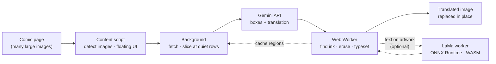

<div align="center">


# COMIC TRANS

**Translate comics, manga & webtoons right on the page — the original text is erased stroke by stroke, then the translation is redrawn in place.**

[](https://github.com/ToanCreator/COMIC-TRANS/releases)
[](LICENSE)
[](#-free--open-source)
[](https://github.com/ToanCreator/COMIC-TRANS)
[](#-tech-stack)
[](#-tech-stack)
[](#-contributing)

**🌐 English** · [Tiếng Việt](README.vi.md) · [简体中文](README.zh-CN.md) · [日本語](README.ja.md)

<!-- ⬇️ Replace the links below with your real store URLs -->
[](https://addons.mozilla.org/firefox/addon/comic-trans/)
[](https://chromewebstore.google.com/detail/YOUR-EXTENSION-ID)
<!-- When the Chrome version is published, change "Coming%20soon" to "Get%20the%20extension" -->

</div>

---

<!-- 📸 Add a demo GIF or before/after screenshot here, e.g.:
<p align="center"></p>
-->

## ✨ What is COMIC TRANS?

Most comic translators just paste a text box on top of the original lettering. **COMIC TRANS** goes further: it **detects the actual ink pixels of the original text, erases them, repairs the artwork underneath, and redraws the translation** so the page looks like it was published in your language.

You bring your own [Google Gemini](https://ai.google.dev/) API key. Everything else — image processing, text removal, typesetting, caching — runs **locally in your browser**.

> Built mobile-first (Firefox for Android works), but it feels just as good on desktop.

## 🚀 Features

| | |
|---|---|
| 🧽 **Real text removal** | Erases the original lettering stroke by stroke, not with a blurry rectangle. Speech-bubble borders stay intact. |
| 🖌️ **Smart typesetting** | The translation is fitted inside the bubble, stops at borders and untouched artwork, and never overlaps other text. |
| 📜 **Webtoon-friendly** | Long strips are sliced at *empty rows between panels*, so lettering is never cut in half. |
| ⚡ **Fast & parallel** | Per-key concurrency limits, automatic slow-down on HTTP 429 and automatic speed-up when things recover. Add several keys to multiply throughput. |
| 📱 **Touch-first UI** | Floating button, tap-to-pick an image, finger-drawn selection to re-translate tiny text, 44px+ touch targets. |
| 🔁 **Instant re-render** | Text regions are cached per image — change the font or size and the page redraws **without another API call**. |
| 🧠 **Self-correcting** | Optional proofreading pass fixes nonsense words / typos; Vietnamese diacritics are auto-restored if the model drops them. |
| 📖 **Glossary & tone notes** | Keep names consistent, define pronouns and speech style per series. |
| 📄 **Export to PDF** | Save the translated chapter as a PDF (generated in-house, no PDF library). |
| 🌍 **180+ languages** | Translate between any pair Gemini supports. UI in **English, Tiếng Việt, 日本語, 中文**. |
| 🤖 **AI text removal (LaMa)** *(optional)* | Erase text drawn directly on artwork with the **LaMa** inpainting model. It runs **inside your browser** (ONNX Runtime + WebAssembly), is downloaded once (~208 MB) and cached. Any error falls back automatically to the fast method. |
| 🪟 **Panels & system windows** | Game-style status windows, notifications and long multi-line text panels are recognised as their own type and refilled as flat panels. |
| 🔒 **Private by design** | No account, no telemetry, no server of ours. See [Privacy](#-privacy--security). |

## 🆕 What's new in 2.6.0

*Changes since 2.3.0.*

- 🤖 **AI text removal with LaMa** — optional, off by default, fully local. Aimed at text on textured artwork, where the classic fill can look soft. [Details](#-optional-ai-text-removal-lama)
- 🪟 **New region type: system windows / long text panels** (new setting, on by default).
- 🧵 **Hairline seam patching** — 1–3 px straight lines (image stitches, panel joints) are treated as background, so text touching them can still be erased and bubbles aren't split in two.
- 🫧 **More robust bubble "pockets"** — bubble backgrounds are now computed *after* the outline is known and sealed with a 3 px barrier, so spiky or gapped outlines still contain their text.
- 📊 **Model manager in Settings** — progress bar with speed, ETA and elapsed time, cancel button, and *Delete downloaded model*.

## 📦 Installation

### Firefox (recommended)

1. Open the add-on page → **[Get COMIC TRANS for Firefox](https://addons.mozilla.org/firefox/addon/comic-trans/)**
2. Click **Add to Firefox**.

### Chrome / Edge / Brave

Coming soon — see the [Roadmap](#-roadmap). Track progress in the [issues](https://github.com/ToanCreator/COMIC-TRANS/issues).

### From source (any Firefox, for developers)

```bash
git clone https://github.com/ToanCreator/COMIC-TRANS.git
```

1. Open `about:debugging#/runtime/this-firefox`
2. Click **Load Temporary Add-on…** and select `manifest.json`
3. The Settings tab opens automatically.

> Temporary add-ons are removed when Firefox closes. For a permanent install, use the store version or sign your own build with `web-ext sign`.

## 🧭 Quick start

1. **Get a free Gemini API key** at [Google AI Studio](https://aistudio.google.com/apikey).
2. Open **COMIC TRANS → Settings**, paste the key (one per line — more keys = more speed), press **Test key**.
3. Pick your **source** and **target** language.
4. Open any comic page and tap the **floating button** (bottom-right, draggable).

| Mode | What it does |
|---|---|
| **Translate page** | Visible images first, the rest in parallel |
| **Current image** | Only the image in the middle of the screen |
| **From here down** | Current image + everything below — perfect for webtoons |
| **Tap to pick** | Tap any image to translate just that one |
| **Select area** | Draw around tiny text; the area is zoomed in and merged into the result |
| **Auto-translate on scroll** | Upcoming images are translated before you reach them |
| **View original / Export PDF** | Compare or save your work |

**Desktop shortcuts:** `Alt+Shift+T` show/hide panel · `Alt+Shift+Y` translate page · right-click an image → *Translate this image*.

### 🤖 Optional: AI text removal (LaMa)

1. In **Settings → AI text removal (LaMa)**, tick *Erase text on artwork with AI* (keep *Text directly on artwork* enabled).
2. Press **Download / check model**. It is a **one-time download** (~208 MB with the default model), with a progress bar, speed and ETA, and a cancel button. The model is saved in the browser's cache storage; remove it any time with *Delete downloaded model*.
3. Translate as usual. Text on textured artwork is now erased by LaMa; speech bubbles and flat panels still use the fast method.

> If you skip step 2, the model starts downloading automatically on your first translation.
> The ONNX Runtime files live in `vendor/` (~40 MB). If your copy of the repo doesn't have them, run `tools/get-lama-assets.sh` (or `.ps1` on Windows).
> Slower than the default, especially on phones. It never blocks translation: on any error the fast result is kept.

## ⚙️ How it works



1. **Detect** — the content script finds comic-sized images (including lazy-loaded ones) and shows a lightweight Shadow-DOM control panel that can't clash with the site's CSS.
2. **Slice** — long strips are cut at the quietest horizontal rows between panels, not at fixed heights.
3. **Ask the model for *less*** — Gemini only returns what a vision model is good at: **text boxes, the translation, and a region type** (bubble, caption, free text, sound effect, system panel). Heavy lifting stays on-device.
4. **Find the real ink** — the model's boxes are often too small or shifted, so they are used only as *seeds*. The Worker grows them along neighbouring strokes inside the same speech bubble (flood-fill on the local background; top-hat / black-hat morphology for text on artwork) to get the full lettering mask. Hairline seams and outline gaps are patched first so bubbles stay separate.
5. **Erase — fast path** — pixels inside the mask are inpainted (push-pull fill + matched film grain), so edits blend with the artwork. If no text is found, **the image is left untouched**. Bubbles and flat backgrounds (coloured boxes, flat-colour sky) always use this exact method.
6. **Erase — optional AI path** — when *AI text removal* is on and the text sits on genuinely textured artwork, the result is refined by **LaMa**: a square crop with generous context is cut around the mask, resized to **512 × 512** and sent to a single dedicated worker running the model through ONNX Runtime Web (WebAssembly). Only the pixels **inside the mask** are pasted back; everything else is untouched. On any error or timeout the fast result is kept.
7. **Typeset** — the translation is wrapped and fitted into the free area, stopping before borders or any ink that wasn't erased.
8. **Cache** — regions are saved per image; restyling is instant and free.

## 🛠️ Engineering highlights

*For the curious — and for anyone reviewing the code.*

- **Almost no dependencies.** Vanilla JavaScript (ES2020), WebExtension APIs, Web Workers. No bundler, no framework, no `node_modules` at runtime. The only third-party runtime is **ONNX Runtime Web** (vendored in `vendor/`), loaded only when AI removal is enabled.
- **Pure, testable core.** `worker/core.js` has no DOM access, so the same algorithms run in a Web Worker **and** in Node for tests.
- **Computer-vision pipeline from scratch.** Dominant-colour analysis, row/column ink statistics, morphological opening/closing, connected-component grouping, seam patching, push-pull inpainting, noise estimation + grain synthesis, IoU de-duplication.
- **Neural inpainting, integrated carefully.** One shared LaMa worker serves the whole worker pool through per-worker `MessageChannel` ports (the model is loaded once, not once per worker); requests are serialised; the crop/tensor/paste-back logic lives in a pure module (`lamafill.js`); the model's output range (0–1 or 0–255) is auto-detected; a 120 s timeout and a graceful fallback mean AI can never break a translation.
- **Model delivery done right.** Streaming download with progress, speed and ETA; the buffer is pre-allocated from `Content-Length` to avoid doubling RAM on phones; the model is persisted in Cache Storage; runtime files are checked *before* downloading hundreds of MB.
- **Resilient API client.** Probes what each model accepts (thinking → safety → JSON-schema) with a tiny test image and degrades gracefully; salvages truncated JSON; handles 429 with per-key adaptive concurrency; detects keys that share a quota project.
- **Never blocks the page.** Heavy pixel work runs in a pool of Workers sized to the CPU core count.
- **Own PDF writer.** The chapter export is generated by a small hand-written PDF serializer.
- **i18n from day one.** Four UI languages, auto-detected from the browser.
- **Tested in layers.** Algorithm tests on synthetic comic pages, unit & flow tests (model refusals, quota 0, 429, truncated JSON, bad key, 404, missing optional permissions), and real-browser E2E / touch-UI tests with Playwright in a mobile viewport.

## 🔒 Privacy & security

- Your **API key is stored only in your browser** (`browser.storage.local`) and is sent **only** to `generativelanguage.googleapis.com`.
- The extension talks to **two kinds of servers, nothing else**: the **Gemini API** (translation), and — *only if you turn on AI text removal* — a **one-time download of the model file from `huggingface.co`** (the URL is editable in Settings). Your comic images are **never** sent to Hugging Face; the model runs locally and is cached in your browser afterwards.
- No analytics, no tracking, no account.
- ⚠️ To translate, **the images you choose are sent to Google's Gemini API**. Google's terms for your key's plan apply (free-tier data may be used by Google per their current policy — please read it). Don't translate content you aren't comfortable sending.
- Never share screenshots exposing the `x-goog-api-key` header. If a key leaks, revoke it and create a new one.

## 🧰 Tech stack

`JavaScript` · `WebExtensions (Firefox, Manifest V2)` · `Web Workers` · `Canvas / ImageData` · `Google Gemini API` · `ONNX Runtime Web (WASM)` · `LaMa inpainting (ONNX)` · `Node.js + Playwright (tests)`

## 🗂️ Project structure

```
COMIC-TRANS/
├── manifest.json          # WebExtension manifest (v2.6.0)
├── background/
│   ├── main.js            # orchestration: fetch, slice, queue, cache, per-key concurrency,
│   │                      #   worker pool + LaMa model download/cache/startup
│   ├── gemini.js          # Gemini client: prompts, parsing, retries, self-test
│   └── settings.js        # defaults & storage
├── content/content.js     # image detection, floating panel (Shadow DOM), touch gestures, PDF export
├── worker/
│   ├── core.js            # pure algorithms: ink mask, seams, inpainting, typesetting, slicing
│   ├── worker.js          # image worker: slice, erase, typeset, LaMa client
│   ├── lamafill.js        # pure LaMa pre/post-processing: crop plan, 512×512 tensors, paste-back
│   └── lama_worker.js     # the single worker that runs the ONNX session
├── vendor/                # ONNX Runtime Web 1.17.3 (JS + WASM) — used only by AI removal
├── options/               # settings page (incl. model manager)
├── shared/                # i18n strings (en/vi/ja/zh) & language list
├── tools/                 # get-lama-assets.sh / .ps1 — fetches the vendor files
└── tests/                 # unit, flow, algorithm and browser E2E tests
```

## 🧪 Development & tests

```bash
cd tests
python3 make_synth.py && python3 make_tall.py && python3 make_widths.py   # synthetic comic pages
node test_units.js && node test_flow.js && node run_core.js               # unit + flow + core
node browser_worker_test.js && node browser_content_test.js && node browser_e2e_test.js  # needs Playwright + Chromium
```

> **Honest status:** automated tests ran against the real Worker, content script and background flow in **Chromium** with Gemini mocked. Testing on real Firefox (desktop & Android), the live Gemini API and many real manga sites is ongoing — bug reports are very welcome.
>
> Feedback on the optional AI-erase path on real devices (especially phones) is also very welcome.

## ⚠️ Known limitations

- **AI text removal** (optional): the default model is a **~208 MB** one-time download; start-up takes **10–60 s** (longer on phones). It runs on the **CPU via WebAssembly on a single thread** (multi-threading needs cross-origin isolation, which extensions don't get), so it is slower than the default method. The model works at 512 × 512, so very large areas are processed at reduced resolution. It only applies to text on textured artwork.
- Without AI removal, text over highly detailed artwork is erased cleanly but the fill can look slightly soft — turn on LaMa, or turn off *"Text directly on artwork"* if you prefer to leave it.
- Rotated / curved text and lettering glued to bubble borders are not handled specially; vertical text is only size-estimated.
- Only fonts installed on your system are used (choose one with the glyphs your target language needs).
- Images inside `<iframe>`s are not supported yet.

## 📍 Roadmap

- [ ] 🟦 **Chrome / Edge / Brave** version (Manifest V3, offscreen document)
- [x] 🧠 Neural inpainting (LaMa via `onnxruntime-web`) for text on artwork — **shipped in 2.6.0 (optional)**
- [ ] 🚀 Faster AI erase (WebGPU backend, smaller quantised model)
- [ ] 🖥️ Optional self-hosted mode (detector + OCR + inpainting on GPU; Gemini translates text only)
- [ ] ⏩ Streaming responses so drawing starts before the model finishes
- [ ] 🌐 More UI languages (PRs welcome!)

## 🤝 Contributing

Contributions of any size are welcome — bug reports, new UI translations, algorithm improvements, docs.

1. Fork the repo and create a branch: `git checkout -b feature/my-idea`
2. Make your change and run the tests in `tests/`
3. Open a Pull Request describing *what* and *why*

**Translate this README or the UI:** copy `README.md` to `README.<lang>.md` (for example `README.ko.md`) and add it to the language bar at the top; UI strings live in `shared/i18n.js`.

## 💚 Free & open source

COMIC TRANS is **100% free** — no ads, no paywall, no premium tier — and **open source** under the **MIT License**. Read it, fork it, learn from it, improve it. You only pay Google directly for API usage *if* you exceed your plan's free quota.

## 🙏 Credits & third-party

COMIC TRANS's own code is MIT-licensed. Third-party components keep their own licenses:

- **LaMa** — *Resolution-robust Large Mask Inpainting with Fourier Convolutions*, Suvorov et al., WACV 2022 · [advimman/lama](https://github.com/advimman/lama) · Apache-2.0
- **LaMa ONNX export** — [Carve/LaMa-ONNX](https://huggingface.co/Carve/LaMa-ONNX) · Apache-2.0. The model is **not bundled** in this repository; it is downloaded on demand.
- **ONNX Runtime Web 1.17.3** — Microsoft · MIT · vendored in `vendor/`
- **Google Gemini API** — OCR + translation

## 📄 License

Released under the [MIT License](LICENSE). Comics and webtoons you translate remain the property of their creators — please support the original authors and respect copyright and each site's terms of use.

## 👤 Author

Made with ☕ by **[ToanCreator](https://github.com/ToanCreator)**.
If this project helped you, a ⭐ on the repo means a lot!

<div align="center">

[⬆ Back to top](#comic-trans)

</div>
