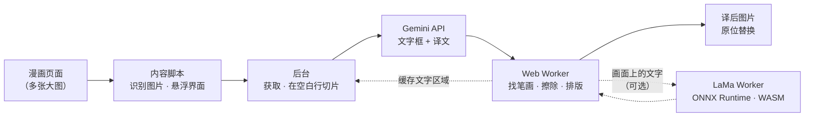

<div align="center">


# COMIC TRANS

**在网页上直接翻译漫画、日漫和条漫——逐笔擦除原文，再把译文原位重绘。**

[](https://github.com/ToanCreator/COMIC-TRANS/releases)
[](LICENSE)
[](#-免费与开源)
[](https://github.com/ToanCreator/COMIC-TRANS)
[](#-技术栈)
[](#-技术栈)
[](#-参与贡献)

[English](README.md) · [Tiếng Việt](README.vi.md) · **🌐 简体中文** · [日本語](README.ja.md)

<!-- ⬇️ 请把下面的链接替换为真实的商店地址 -->
[](https://addons.mozilla.org/firefox/addon/comic-trans/)
[](https://chromewebstore.google.com/detail/YOUR-EXTENSION-ID)
<!-- Chrome 版发布后，把 "%E5%8D%B3%E5%B0%86%E6%8E%A8%E5%87%BA"（即将推出）改为 "%E8%8E%B7%E5%8F%96%E6%89%A9%E5%B1%95"（获取扩展） -->

</div>

---

<!-- 📸 在此添加演示 GIF 或前后对比截图，例如：
<p align="center"></p>
-->

## ✨ COMIC TRANS 是什么？

大多数漫画翻译工具只是在原文上盖一个文本框。**COMIC TRANS** 走得更远：它会**识别原文真正的墨迹像素、将其擦除、修补下方的画面，再把译文重新绘制上去**，让整页看起来就像用你的语言正式出版的一样。

你只需使用**自己的 [Google Gemini](https://ai.google.dev/) API 密钥**。其余所有工作——图像处理、文字擦除、排版、缓存——都**在你的浏览器本地完成**。

> 以手机端优先设计（支持 Firefox for Android），在桌面端同样流畅。

## 🚀 功能

| | |
|---|---|
| 🧽 **真正的文字擦除** | 逐笔擦除原文，而不是涂一块模糊的矩形。对话气泡的边框完整保留。 |
| 🖌️ **智能排版** | 译文适配气泡大小，遇到边框或未擦除的笔画就停止，不会覆盖其他文字。 |
| 📜 **适配条漫** | 长图在*分格之间的空白行*处切分，绝不会把文字切成两半。 |
| ⚡ **快速并行** | 每个密钥单独限流，遇到 HTTP 429 自动降速、恢复后自动提速。添加多个密钥可成倍提升速度。 |
| 📱 **触控优先界面** | 悬浮按钮、点按选图、手指圈选重译小字，触控目标不小于 44px。 |
| 🔁 **即时重绘** | 每张图的文字区域都会缓存——更换字体或字号后立即重绘，**无需再次调用 API**。 |
| 🧠 **自我纠错** | 可选的校对步骤会修正无意义词语/错别字；若模型丢失越南语声调，会自动补全。 |
| 📖 **术语表与语气备注** | 为每部作品保持人名一致，并约定称呼和文风。 |
| 📄 **导出 PDF** | 将译好的章节保存为 PDF（自行生成，不依赖 PDF 库）。 |
| 🌍 **180+ 种语言** | 支持 Gemini 能处理的任意语言对。界面提供 **English、Tiếng Việt、日本語、中文**。 |
| 🤖 **AI 擦除文字（LaMa）** *(可选)* | 用 **LaMa** 图像修复模型擦除直接写在画面上的文字，**完全在浏览器内运行**（ONNX Runtime + WebAssembly）。模型只需下载一次（约 208 MB）并缓存。出错时自动回退到快速方法。 |
| 🪟 **面板与系统窗口** | 将游戏风格的状态窗口、通知和多行长文字面板识别为独立类型，并按平整面板进行填补。 |
| 🔒 **隐私优先** | 无需账号、无遥测、无自建服务器。详见[隐私与安全](#-隐私与安全)。 |

## 🆕 2.6.0 新内容

*相对于 2.3.0 的变化。*

- 🤖 **LaMa AI 擦除文字** — 可选，默认关闭，完全本地运行。针对带纹理画面上的文字——传统填补在这类位置可能显得模糊。[详情](#-可选ai-擦除文字lama)
- 🪟 **新增区域类型：系统窗口／长文字面板**（新增设置项，默认开启）。
- 🧵 **细线接缝修补** — 1–3 px 的笔直细线（图片拼接痕、分格接缝）被视为背景，因此贴着线的文字仍可擦除，气泡也不会被一分为二。
- 🫧 **更稳健的气泡“口袋”** — 现在在确定轮廓*之后*再计算气泡背景，并用 3 px 屏障封口，即使轮廓带毛刺或有缺口，也能正确包含其中的文字。
- 📊 **设置页内的模型管理** — 进度条显示速度、剩余时间和已用时间，支持取消下载，以及*删除已下载的模型*。

## 📦 安装

### Firefox（推荐）

1. 打开扩展页面 → **[获取 Firefox 版 COMIC TRANS](https://addons.mozilla.org/firefox/addon/comic-trans/)**
2. 点击**添加到 Firefox**。

### Chrome / Edge / Brave

即将推出——见[路线图](#-路线图)。可在 [Issues](https://github.com/ToanCreator/COMIC-TRANS/issues) 关注进度。

### 从源码安装（任意 Firefox，面向开发者）

```bash
git clone https://github.com/ToanCreator/COMIC-TRANS.git
```

1. 打开 `about:debugging#/runtime/this-firefox`
2. 点击 **Load Temporary Add-on…** 并选择 `manifest.json`
3. 设置页会自动打开。

> 临时扩展会在关闭 Firefox 后移除。如需永久安装，请使用商店版本，或用 `web-ext sign` 为自己的构建签名。

## 🧭 快速上手

1. 在 [Google AI Studio](https://aistudio.google.com/apikey) **获取免费的 Gemini API 密钥**。
2. 打开 **COMIC TRANS → 设置**，粘贴密钥（每行一个——密钥越多越快），点击**检查密钥**。
3. 选择**源语言**和**目标语言**。
4. 打开任意漫画页面，点击**悬浮按钮**（右下角，可拖动）。

| 模式 | 作用 |
|---|---|
| **翻译整页** | 先翻译正在查看的图片，其余并行处理 |
| **当前图片** | 只翻译屏幕中央的图片 |
| **从此处向下** | 当前图片及其后的所有图片——最适合条漫 |
| **点按选图** | 点哪张图就翻译哪张 |
| **圈选区域** | 圈出小字，区域会被放大识别并合并进结果 |
| **滚动时自动翻译** | 即将滚动到的图片会提前翻译 |
| **查看原图 / 导出 PDF** | 对比或保存成果 |

**桌面快捷键：** `Alt+Shift+T` 显示/隐藏面板 · `Alt+Shift+Y` 翻译整页 · 右键图片 → *翻译此图片*。

### 🤖 可选：AI 擦除文字（LaMa）

1. 打开 **设置 → AI 擦除文字（LaMa）**，勾选*用 AI 擦除画面上的文字*（并保持*直接写在画面上的文字*开启）。
2. 点击 **下载 / 检查模型**。默认模型**只需下载一次（约 208 MB）**，带进度条、速度、剩余时间和取消按钮。模型保存在浏览器缓存存储中，可随时通过*删除已下载的模型*移除。
3. 照常翻译即可。带纹理画面上的文字将由 LaMa 擦除；气泡和平整面板仍使用快速方法。

> 如果跳过第 2 步，首次翻译时模型会自动开始下载。
> ONNX Runtime 文件位于 `vendor/`（约 40 MB）。如果你的仓库副本里没有，请运行 `tools/get-lama-assets.sh`（Windows 用 `.ps1`）。
> 比默认方式慢，手机上尤其明显。它不会阻塞翻译：出错时会保留快速方法的结果。

## ⚙️ 工作原理



1. **识别** — 内容脚本找出漫画尺寸的图片（含懒加载图片），并显示一个基于 Shadow DOM 的轻量控制面板，不会与网站 CSS 冲突。
2. **切片** — 长条漫画在分格之间最“安静”的横向行切开，而不是按固定高度切。
3. **让模型做*更少*的事** — Gemini 只返回视觉模型擅长的内容：**文字框、译文和区域类型**（气泡、旁白、自由文字、拟声词、系统面板）。繁重的工作留在本机完成。
4. **找出真正的笔画** — 模型给出的框常常偏小或偏移，所以只当作“种子”。Worker 沿同一气泡内相邻的笔画向外生长（在局部背景上做 flood-fill；画面上的文字则用 top-hat / black-hat 形态学）以得到完整的文字掩码。细线接缝和轮廓缺口会先被修补，避免相邻气泡粘连。
5. **擦除 — 快速路径** — 掩码内的像素用 push-pull 填补并叠加匹配的胶片颗粒，使修改处与画面融为一体。若未找到文字，**图片保持不变**。气泡和平整背景（彩色框、纯色天空）始终使用这种精确方法。
6. **擦除 — 可选 AI 路径** — 当开启 *AI 擦除文字* 且文字位于真正带纹理的画面上时，用 **LaMa** 进一步优化：围绕掩码裁出带有充足上下文的正方形，缩放到 **512 × 512**，发送给唯一的专用 Worker，通过 ONNX Runtime Web（WebAssembly）运行模型。只有**掩码内**的像素会被贴回，其余部分保持不变。出错或超时则保留快速路径的结果。
7. **排版** — 译文自动换行并适配可用空间，遇到边框或未擦除的笔画前停止。
8. **缓存** — 文字区域按图片保存；更换样式即时完成，无需再次请求。

## 🛠️ 工程亮点

*写给好奇的你——以及正在审阅代码的人。*

- **几乎没有依赖。** 原生 JavaScript（ES2020）、WebExtension API、Web Worker。无打包器、无框架、运行时无 `node_modules`。唯一的第三方运行时是 **ONNX Runtime Web**（放在 `vendor/`），仅在开启 AI 擦除时才加载。
- **纯粹、可测试的核心。** `worker/core.js` 不访问 DOM，因此同一套算法既能在 Web Worker 中运行，也能在 Node 中测试。
- **从零实现的计算机视觉流水线。** 主色分析、行/列笔画统计、形态学开/闭运算、连通域分组、接缝修补、push-pull 图像修复、噪声估计与颗粒合成、基于 IoU 的去重。
- **谨慎集成神经网络修复。** 一个共享的 LaMa Worker 通过每个图像 Worker 专属的 `MessageChannel` 端口服务整个 Worker 池（模型只加载一次）；请求串行执行；裁剪／张量／贴回逻辑放在纯模块 `lamafill.js` 中；自动识别模型输出范围（0–1 或 0–255）；120 秒超时加优雅回退，保证 AI 不会破坏一次翻译。
- **规范的模型分发。** 流式下载并显示进度、速度和剩余时间；按 `Content-Length` 预分配缓冲区，避免手机内存翻倍；模型持久保存在 Cache Storage；在下载数百 MB 之前先检查运行库文件是否齐全。
- **健壮的 API 客户端。** 用一张极小的测试图探测每个模型接受的配置（thinking → safety → JSON schema）并平滑降级；能抢救被截断的 JSON；用按 key 自适应并发处理 429；能识别共用同一配额项目的 key。
- **绝不卡住页面。** 繁重的像素处理在按 CPU 核心数确定大小的 Worker 池中运行。
- **自写 PDF 生成器。** 章节导出由一个手写的小型 PDF 序列化器生成。
- **从一开始就支持多语言。** 4 种界面语言，自动跟随浏览器。
- **分层测试。** 合成漫画页的算法测试、单元与流程测试（模型拒绝、配额为 0、429、JSON 被截断、key 错误、404、缺少可选权限），以及在手机视口下用 Playwright 做的真实浏览器 E2E／触屏测试。

## 🔒 隐私与安全

- **API key 仅保存在你的浏览器中**（`browser.storage.local`），并且**只会**发送到 `generativelanguage.googleapis.com`。
- 扩展**只与两类服务器通信**：**Gemini API**（翻译），以及——*仅在你开启 AI 擦除时*——**从 `huggingface.co` 一次性下载模型文件**（地址可在设置中修改）。你的漫画图片**绝不会**发送给 Hugging Face；模型在本地运行，之后缓存在你的浏览器里。
- 无统计、无跟踪、无需账号。
- ⚠️ 翻译时，**你选择的图片会发送到 Google 的 Gemini API**。适用 Google 针对你所用 key 套餐的条款（免费层的数据可能会被 Google 按其现行政策使用——请自行阅读）。不想外发的内容请不要翻译。
- 切勿分享暴露 `x-goog-api-key` 请求头的截图。若 key 泄露，请立即撤销并重新创建。

## 🧰 技术栈

`JavaScript` · `WebExtensions（Firefox，Manifest V2）` · `Web Workers` · `Canvas / ImageData` · `Google Gemini API` · `ONNX Runtime Web (WASM)` · `LaMa 图像修复 (ONNX)` · `Node.js + Playwright（测试）`

## 🗂️ 项目结构

```
COMIC-TRANS/
├── manifest.json          # WebExtension 清单（v2.6.0）
├── background/
│   ├── main.js            # 调度：获取、切片、队列、缓存、按 key 并发、
│   │                      #   Worker 池 + LaMa 模型下载/缓存/启动
│   ├── gemini.js          # Gemini 客户端：提示词、解析、重试、自检
│   └── settings.js        # 默认值与存储
├── content/content.js     # 图片识别、悬浮面板（Shadow DOM）、触屏手势、PDF 导出
├── worker/
│   ├── core.js            # 纯算法：笔画掩码、接缝、图像修复、排版、切片
│   ├── worker.js          # 图像 Worker：切片、擦除、排版、LaMa 客户端
│   ├── lamafill.js        # LaMa 前/后处理（纯逻辑）：裁剪方案、512×512 张量、贴回
│   └── lama_worker.js     # 唯一运行 ONNX 会话的 Worker
├── vendor/                # ONNX Runtime Web 1.17.3（JS + WASM）——仅 AI 擦除使用
├── options/               # 设置页（含模型管理）
├── shared/                # 界面文案（en/vi/ja/zh）与语言列表
├── tools/                 # get-lama-assets.sh / .ps1 — 下载 vendor 文件
└── tests/                 # 单元、流程、算法与浏览器 E2E 测试
```

## 🧪 开发与测试

```bash
cd tests
python3 make_synth.py && python3 make_tall.py && python3 make_widths.py   # 生成合成漫画页
node test_units.js && node test_flow.js && node run_core.js               # 单元 + 流程 + 核心
node browser_worker_test.js && node browser_content_test.js && node browser_e2e_test.js  # 需要 Playwright + Chromium
```

> **真实状态：** 自动化测试是在 **Chromium** 中使用真实的 Worker、content script 和 background 流程，并模拟 Gemini 运行的。在真实 Firefox（桌面与 Android）、真实 Gemini API 以及众多真实漫画站点上的测试仍在进行中——非常欢迎提交 Bug 报告。
>
> 也非常欢迎在真实设备（尤其是手机）上对可选的 AI 擦除路径提供反馈。

## ⚠️ 已知限制

- **AI 擦除文字**（可选）：默认模型**约 208 MB**，只需下载一次；启动需 **10–60 秒**（手机上更久）。它在 **CPU 上通过 WebAssembly 单线程**运行（多线程需要跨源隔离，扩展无法获得），因此比默认方式慢。模型工作分辨率为 512 × 512，所以特别大的区域会以较低分辨率处理。仅作用于带纹理画面上的文字。
- 未开启 AI 擦除时，细节丰富的画面上的文字可以被干净擦除，但填补处可能略显模糊——请开启 LaMa，或关闭*“直接写在画面上的文字”*以保持原样。
- 旋转／弯曲的文字以及紧贴气泡边框的文字没有专门处理；竖排文字只做字号估算。
- 只使用系统中已安装的字体（请选择包含目标语言字形的字体）。
- 暂不支持 `<iframe>` 内的图片。

## 📍 路线图

- [ ] 🟦 **Chrome / Edge / Brave** 版本（Manifest V3，offscreen document）
- [x] 🧠 针对画面文字的神经网络图像修复（LaMa，基于 `onnxruntime-web`）——**已在 2.6.0 提供（可选）**
- [ ] 🚀 更快的 AI 擦除（WebGPU 后端、更小的量化模型）
- [ ] 🖥️ 可选的自托管模式（GPU 上的检测器 + OCR + 图像修复；Gemini 只翻译文本）
- [ ] ⏩ 流式响应，在模型返回完毕前就开始绘制
- [ ] 🌐 更多界面语言（欢迎提交 PR！）

## 🤝 参与贡献

无论大小，任何贡献都欢迎——Bug 报告、界面翻译、算法改进、文档。

1. Fork 本仓库并创建分支：`git checkout -b feature/my-idea`
2. 完成修改并运行 `tests/` 中的测试
3. 提交 Pull Request，说明*做了什么*以及*为什么*

**翻译本 README 或界面：** 将 `README.md` 复制为 `README.<语言代码>.md`（例如 `README.ko.md`），并加入顶部的语言栏；界面文案位于 `shared/i18n.js`。

## 💚 免费与开源

COMIC TRANS **完全免费**——没有广告、没有付费墙、没有高级版——并以 **MIT 许可证**开源。欢迎阅读、Fork、学习和改进。仅当你超出所用套餐的免费额度时，才需要直接向 Google 付费。

## 🙏 致谢与第三方组件

COMIC TRANS 自身代码采用 MIT 许可证。第三方组件保留各自的许可证：

- **LaMa** — *Resolution-robust Large Mask Inpainting with Fourier Convolutions*，Suvorov 等，WACV 2022 · [advimman/lama](https://github.com/advimman/lama) · Apache-2.0
- **LaMa 的 ONNX 导出** — [Carve/LaMa-ONNX](https://huggingface.co/Carve/LaMa-ONNX) · Apache-2.0。模型**未包含**在本仓库中，而是按需下载。
- **ONNX Runtime Web 1.17.3** — Microsoft · MIT · 放在 `vendor/`
- **Google Gemini API** — OCR + 翻译

## 📄 许可证

基于 [MIT 许可证](LICENSE)发布。你翻译的漫画和条漫版权仍归原作者所有——请支持原作者，并尊重版权及各网站的使用条款。

## 👤 作者

由 **[ToanCreator](https://github.com/ToanCreator)** 用 ☕ 制作。
如果这个项目对你有帮助，给仓库点个 ⭐ 就是莫大的鼓励！

<div align="center">

[⬆ 回到顶部](#comic-trans)

</div>
